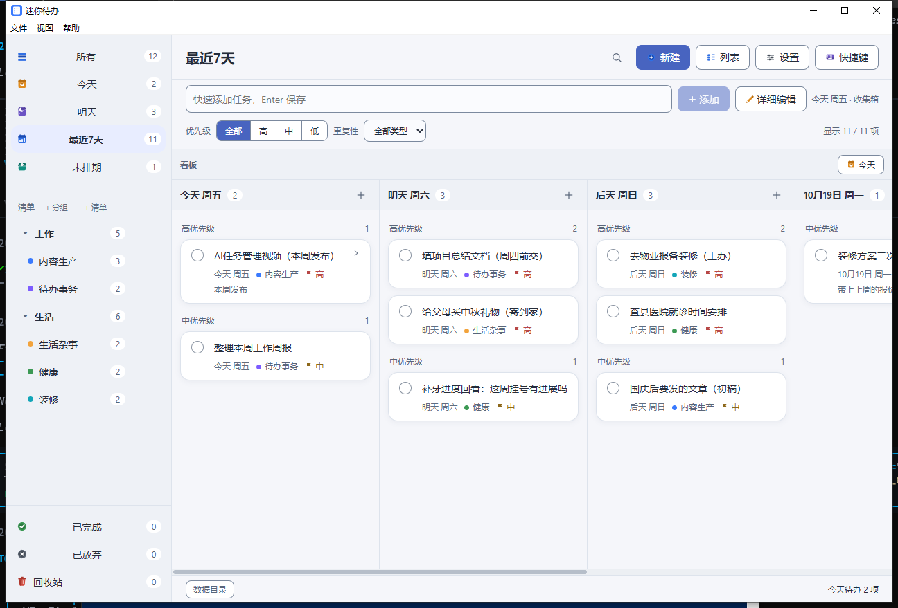
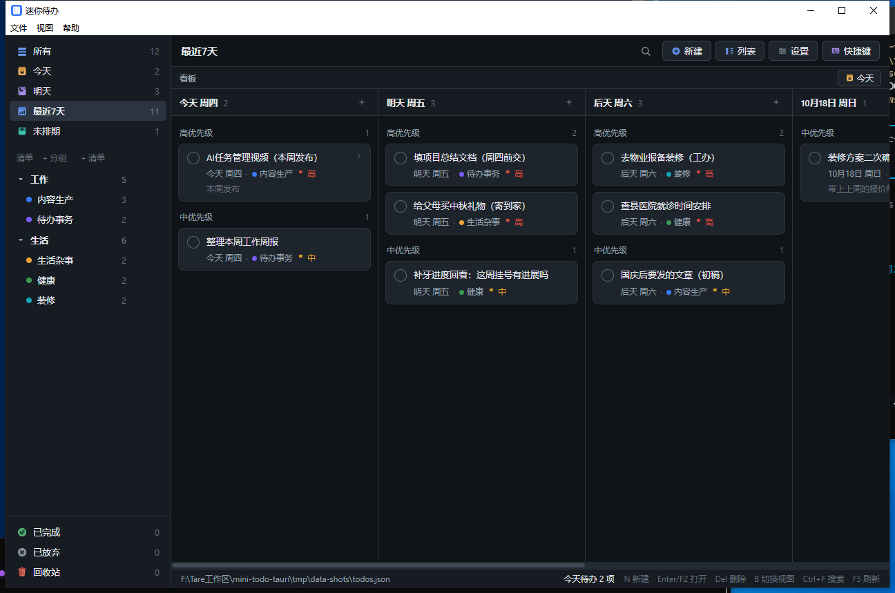
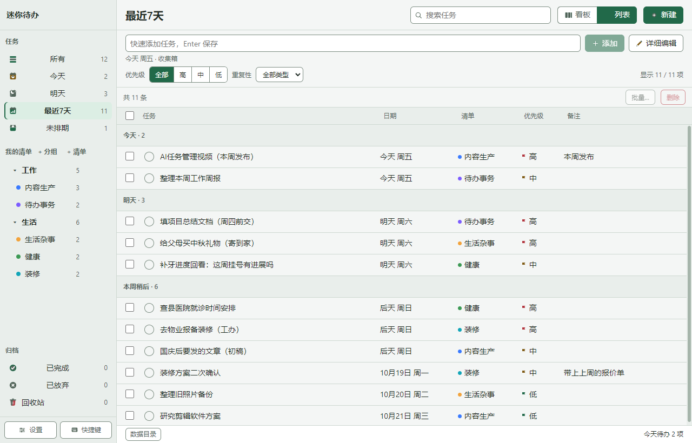

# 迷你待办 MiniTodo（Tauri 版）

看板式待办管理工具，一套代码同时出 32/64 位安装包与绿色版，覆盖内网 Win7 老机器与现代 Win10/11。

这是 [MiniTodo](https://github.com/KongValley/MiniTodo)（C# WinForms / .NET 3.5 单文件版）的 **Rust（Tauri 2）重写**：界面沿用 Electron 版的 Vue 组件（跑在 WebView2 上），宿主/主进程换成 Rust；功能对齐、数据文件完全兼容（都是 `%APPDATA%\MiniTodoElectron\todos.json`），装新版即可，旧版可直接卸载。



## 特性

| 分类 | 内容 |
| --- | --- |
| 视图 | 分组 → 清单两级侧栏；看板（**列随视图过滤**，按日期分列，列内按优先级分组）与列表两种视图，`B` 切换 |
| 侧栏 | 分组与清单可**新建、重命名、删除、拖拽排序**（清单可跨分组拖）。删清单时可选「任务移到收集箱」或「**任务移入回收站**」；删分组则组内清单一并删除、任务统一移到收集箱，全程不丢任务 |
| 重复 | 不重复 / 每天 / 每周 / 每月 / 工作日；**每月记住原始日号**（选 31 号则 1-31 → 2-28 → 3-31，不会卡在 28 号） |
| 任务 | 标题、备注、日期（可「不排期」）、清单、优先级（高/中/低）、状态（待办/已完成/已放弃/回收站） |
| 增强 | **看板拖拽**改期与同优先级桶内排序、**深色/浅色主题**、**托盘常驻 + 到期通知**、**子任务清单**、**重复任务**、**右键菜单**（编辑/复制/改期/改优先级/移动到清单/完成/删除）、**列表列排序**、**搜索词高亮**、**自动备份 + 从备份恢复 + 导入导出**（导入可选替换/合并，导入与恢复都可「撤销」回退）、**导出 Markdown / CSV**、**自绘彩色 SVG 图标**（双主题自适应，零图标库依赖） |
| 效率 | 「**今天**」视图含逾期（卡片/列表行标「逾期 N 天」，与状态栏、托盘同一口径）；列表视图**批量操作**（完成 / 优先级 / 改期 / 移动清单，选中后点「批量…」）；**删除可撤销**（底部提示 4 秒内点「撤销」即整棵还原，连彻底删除也能救回）；**复制任务**（`Ctrl+D`）、**剪贴板批量新建**（`Ctrl+V`，每行一条）、**保存并新建**（连续录入）、右键**移动到清单**；搜索命中**标题 / 备注 / 子任务 / 清单名 / 分组名** |
| 整理 | 「已完成」视图**按完成日期分段**、段内按完成时间倒序，工具条给出「近 7 天完成 N 条」并能「**清理早于 7 / 30 / 90 天**」；「已放弃」视图可**一键清空**；两者都只移入回收站（可恢复）且带「撤销」 |
| 回收站 | 侧栏回收站行悬停出现「**清空**」；进入回收站的项保留 `deletedAt`，**超过 30 天在启动时静默清理**（旧数据无此字段则永不清理） |
| 记忆 | **窗口尺寸与位置**、**上次视图**都记在 `settings.json`，下次启动原地还原；坐标不在任何显示器内时（换屏/拔外接屏）回落默认位置，绝不把窗口丢到屏幕外 |
| 提醒 | 全局提醒时间 + 托盘菜单/状态栏的「**稍后提醒 10 分钟**」（到点穿透「同日不重复」再提醒一次） |
| 数据 | `%APPDATA%\MiniTodoElectron\todos.json`，UTF-8 明文，可直接备份/编辑；**每次改动按需自动备份**到 `backups/`（每天一份，保留最新 10 份），「文件 → 从备份恢复…」列出这些备份一键恢复 |
| 迁移 | 「文件 → 导入旧版数据…」默认指向 `%APPDATA%\MiniTodo\todos.json`，一次性导入旧版数据（导入前自动备份）；「文件 → 导出为 Markdown / CSV…」导出可读文本（CSV 带 BOM，Excel 直接打开不乱码） |

## 快捷键

| 键 | 作用 |
| --- | --- |
| `N` | 新建任务 |
| `Enter` / `F2` | 打开选中任务（列表视图） |
| `Del` | 删除选中（回收站视图里是彻底删除） |
| `↑` `↓` | 列表视图移动选中行（`Shift` 连选，选中行自动滚进视口） |
| `Home` / `End` | 列表视图跳到首 / 尾行 |
| `←` `→` | 看板视图左右滚动一列 |
| `Ctrl+D` | 复制选中任务（新 id、待办、子任务重置） |
| `Ctrl+V` | 剪贴板批量新建任务（每行一条；输入框内仍是原生粘贴） |
| `B` | 切换看板 / 列表 |
| `Ctrl+1` / `Ctrl+2` | 菜单「视图 → 看板 / 列表」 |
| `Ctrl+A` | 列表视图全选当前视图（输入框内仍是原生全选文本） |
| `Ctrl+F` | 搜索 |
| `Esc` | 关闭弹窗 / 清空搜索 |
| `F5` | 刷新 |
| `1` `2` `3` `4` | 今天 / 明天 / 最近7天 / 所有 |
| 看板内滚轮 | 上下滚动鼠标所在列 |
| `Ctrl` + 滚轮 | 看板内左右滚动日期列 |
| 拖拽卡片 | 改期 / 同优先级桶内排序 |

## 界面

左侧是视图与清单（分组 → 清单两层，每行右侧显示条数，视图行配彩色图标）；「清单」标题右侧有「+ 分组」「+ 清单」两个入口，分组与清单行鼠标移上去会出现重命名与删除图标，两行之间可拖拽调整顺序（清单可拖到别的分组下）。顶栏是视图名、搜索、新建、视图切换、设置、快捷键；底部状态栏显示数据文件路径、今日待办数与快捷键提示。

窗口用系统原生标题栏，带常显的菜单栏（旧 Electron 版是 Alt 才显示）。**关闭窗口 = 隐藏到托盘**（托盘常驻），真正退出走「文件 → 退出」或右键托盘图标 →「退出」。应用已在后台运行时**再次双击 exe 会把窗口唤到最前**（单实例锁，不会开出第二个实例）。

<table>
<tr>
<td></td>
<td></td>
</tr>
</table>

## 使用

### 安装版 / 绿色版

`release/` 下按系统与架构分目录：

| 目录 | 适用 |
| --- | --- |
| `Win7-32位` | Windows 7 SP1 32 位（64 位系统两种包均可，32 位系统必须用这个） |
| `Win7-64位` | Windows 7 SP1 64 位；Windows 10 / 11 也直接用这两套包 |

每个目录里有两个分发物，任选其一：

| 文件 | 用法 |
| --- | --- |
| `mini-todo-setup-<版本>-<平台>.exe` | **安装版**：双击走安装向导，装到当前用户目录，自动建开始菜单快捷方式 |
| `mini-todo-portable-<版本>-<平台>.zip` | **绿色版**：解压后双击里面的 exe，无需安装。**建议先建一个专用文件夹再解压**（zip 没有外层目录，直接解压会与当前目录已有文件混在一起） |

两种分发物的启动速度相同（都在本机直接运行，不做解压）。体积参考：安装版约 155 MB（32 位）/ 177 MB（64 位），绿色版约 167/187 MB——包内自带一份 WebView2 109 固定版运行时（只保留 `en-US`/`zh-CN` 语言包，其余 82 个已裁掉）。安装包用 NSIS 的 **bzip2** 档（不是默认 LZMA）：比 LZMA 大约 20%，换来每次打包少花约 100 秒。

**Windows 7 前置要求**：需 **Windows 7 SP1**，并补装 `前置补丁/` 里的 4 个 `.msu`（安装顺序见该目录的《安装说明.txt》，先装 KB4490628 再装 KB4474419）。**运行时不需联网、不需单独安装**。

**Windows 10 / 11**：同一套包直接可用、不需要前置补丁；应用启动时**检测到系统自带 WebView2 就优先用系统版**（更新、持续有安全更新），只有系统没有时才回退包内的 109。

### 数据

- 数据文件：`%APPDATA%\MiniTodoElectron\todos.json`（UTF-8 明文，无 BOM，可直接备份/编辑）
- 首次运行会写入一套示例数据；清空该文件后重启即回到示例数据
- 备份：`%APPDATA%\MiniTodoElectron\backups\todos-<时间戳>.json`，**每天最多一份（每次改动时按需写）**，保留最新 10 份；「文件 → 从备份恢复…」列出全部备份（损坏的会标出并禁用），恢复 = 导入该文件（可选替换/合并，替换后可「撤销」回退），「关于」里也写着备份目录
- 设置：`%APPDATA%\MiniTodoElectron\settings.json`（主题、到期提醒开关与时间）
- 数据文件损坏时不会静默覆盖：原文件改名保留为 `todos.json.corrupt-<时间戳>`（保留最新 5 份），并提示原因
- 旧版数据（`%APPDATA%\MiniTodo\todos.json`）通过「文件 → 导入旧版数据…」导入，导入前自动备份当前数据，并可选「替换」或「合并」（合并按 id 跳过重复项，保留现有任务）
- **写盘失败不会静默**：状态栏持续显示「保存失败，数据未写入磁盘」，直到下一次保存成功——改动仍留在内存里，但不要在提示消失前关窗口

### 与 Electron 版的差异

| 项 | 说明 |
| --- | --- |
| 渲染内核 | WebView2：Win7 用包内固定版 109；Win10/11 检测到系统运行时则优先用系统版（没有才回退包内的 109） |
| 菜单栏 | 常显（旧版按 Alt 才显示，因为 Electron 的 autoHideMenuBar 无法在 Tauri 上等价复现） |
| 安装版 | 一键装到当前用户目录，**不能改安装目录**（旧 electron-builder 向导允许选择） |
| 单实例锁 | 按应用区分，不再按数据目录区分；冒烟/基准这类多实例脚本需串行执行 |
| 数据 | 完全兼容：同一路径、同一格式，旧版数据直接续用 |
| 内存 | WebView2 进程组比旧版 Electron 重：5000 条任务时任务管理器口径约 128 MB（旧版约 83 MB）。主要收益是不再随包携带整套 Chromium |
| 崩溃自愈 | 渲染进程崩溃 → 自动重载页面（连续崩超 3 次停止，需手动重启）；未落盘改动会丢，与旧版一致 |

## 构建

前置：Node ≥ 20、[rustup](https://rustup.rs)（按仓库根的 `rust-toolchain.toml` 自动装 Rust **1.77.2**——Win7 上官方 target 支持的最后版本）、Visual Studio Build Tools（MSVC）。

```bash
npm install          # 前端依赖（vite/vue/vue-tsc/@tauri-apps/cli）
npm run dev          # 开发模式（tauri dev，热更新）
npm run build        # 类型检查 + 构建渲染层到 dist/
npm test             # 共享层纯函数自检（node --test，55 项）
npm run fixtures     # 生成 normalize fixture（Rust 对照用，提交入库）
npm run test:rust    # Rust 宿主单测（normalize 对照 / 数据 IO / 通知规则等，8 项）
npm run smoke        # 端到端冒烟（真窗口 39 项：托盘、通知、单实例、崩溃自愈、保存失败注入、备份恢复、导出字节）
npm run icon         # 重新生成图标（resources/icon.png → src-tauri/icons/）
```

性能基准（改动数据层/渲染层后跑一次，确认没有回归）：

```bash
npm run perf:data    # 生成 tmp/perf-pristine/{500,2000,5000}.json 三档数据
npm run perf         # 三档 × 3 次取中位数，结果写 tmp/perf-current.json
```

### Windows 7 打包的前置材料（首次打 Win7 包前准备）

- `win7-patches/`：4 个 `.msu` 前置补丁（121 MB，已 gitignore，从旧仓库复制或自行下载）
- WebView2 109 固定版运行时：`npm run fetch:runtime`（从种子 Release `webview2-109` 下载 cab 并展开；也可手动把 cab 放进 `webview2-109/`，或把已展开的运行时目录放进 `webview2-runtime-x86/`、`webview2-runtime-x64/`）

打包（每架构一条，产物在 `release/<中文目录>/`）：

```bash
npm run dist             # 两个架构并行打（16 核本机约 2.5 分钟）
npm run dist:win7-32     # 只打 32 位（→ release/Win7-32位/，约 1.5 分钟）
npm run dist:win7-64     # 只打 64 位（→ release/Win7-64位/，约 2.5 分钟）
npm run zip:win7-32      # 快速迭代：只重建 exe + 绿色版 zip，不动安装包（约 1 分钟）
npm run zip:win7-64
```

单组合约 1.5–2.5 分钟，四段成本：cargo release 编译 35–80 秒（`codegen-units = 16`，为打包速度放弃了 `1` 的体积收益）、**NSIS bzip2 压缩约 35 秒**（320 MB 载荷；LZMA 档要 136 秒、安装包小 20%）、绿色版 staging 复制 + `Compress-Archive` 约 20 秒、`vue-tsc` 类型检查约 6 秒（vite 由 tauri 的 `beforeBuildCommand` 跑，脚本不再重复跑第二遍）。`npm run dist` 并发跑两个组合：cargo 对 target 目录加锁会自动串行，单核的 makensis/zip 正好与另一组合的编译重叠（11 分钟 → 2.5 分钟）。CI 是 2 核 runner，请继续用 `dist:win7-32` / `dist:win7-64` 单架构串行。

## 性能

5000 条任务下（同一台机器，`npm run perf` 三次运行的中位数范围；单次运行会受机器负载影响）：

| 交互 | 耗时 | 说明 |
| --- | --- | --- |
| 切换视图 | **15–21 ms** | |
| 切到列表并滚到底 | **28–35 ms** | |
| 完成一条任务 | **14–35 ms** | 同步段 0.2–1.3 ms，其余是索引重建 + 渲染 |
| 拖拽改期 | **11–36 ms** | |
| 新建任务 | **10–27 ms** | |
| 搜索 | **13–28 ms** | |
| 连续完成 3 条 | **11–94 ms**（500→5000 条） | 3 次变更 2–5 ms，只写一次盘；磁盘往返本身随载荷线性增长 |
| 主线程总阻塞 | **0 ms**（三档均为 0） | |
| DOM 卡片数 / 列表行数 | **60 / 60**（窗口化渲染，模型 5000） | |

拆分数据层与渲染层的成本，用审计探针（比总墙钟更能定位回归）：

```bash
# 逐步骤量 syncMs(同步段) / firstFrameMs(首帧) / saveRoundTripMs(落盘往返) / maxGapMs(最长帧间隔)
rm -rf tmp/audit-run && mkdir -p tmp/audit-run
cp tmp/perf-pristine/5000.json tmp/audit-run/todos.json
TODO_SMOKE=1 TODO_SMOKE_SCRIPT=scripts/perf-audit-probe.js \
  TODO_SMOKE_OUT=tmp/audit-out.json TODO_SMOKE_ROOT="$PWD" \
  TODO_DATA_DIR="$PWD/tmp/audit-run" TODO_SMOKE_TIMEOUT=90000 TODO_SMOKE_SETTLE=300 \
  ./src-tauri/target/x86_64-pc-windows-msvc/release/mini-todo.exe
```

关键设计（改这些地方时注意别退回去）：

- **启动即显示**：窗口 `visible: false` 只在 `setup` 里 `show_window()` 后可见（不再等首个 `PageLoadEvent::Finished`），HTML 里带一屏「迷你待办 / 正在启动…」骨架屏（Vue 挂载时自动清掉）。老机器上 WebView2 内核初始化 + 冷盘读入是秒级，先出窗口再填内容，避免「双击没反应」的观感
- **自动低配模式**：`main.ts` 按 `hardwareConcurrency ≤ 2` / `deviceMemory ≤ 4` / UA 含 `Windows NT 6.1`（Win7）任一命中 → `html[data-perf=low]`，只关掉逐卡片 `box-shadow`（唯一按项重复的合成开销），卡片仍有 1px 边线
- `state.store` 用 `markRaw` 包住 —— 派生数据统一由 `store/index.ts` 的 `index` computed 提供，不依赖字段级追踪
- 视图计数/看板列走 `shared/store-index.ts` 的**单次扫描索引**，不是逐视图扫描。**但看板列要走 `query.ts` 的 `columnsForView()`** —— `index.columns` 是全量扫描的结果，直接喂看板会在「今天」视图下仍列出未来日期的列
- 看板卡片与列表行都是**窗口化渲染**（`lib/virtual.ts`），只渲染可视区
- 保存时 store 以**序列化字符串**过 IPC（传对象要结构化克隆 7.5 万个对象）；Rust 侧原样字节落盘，不做逐条转换
- **落盘合并到帧末**：`data.ts` 的 `commit()` 只替换内存里的 store 并把写盘排进 `setTimeout(0)`，同一帧内多次变更只写最后一次（连续完成 3 条从 3 次往返降到 1 次）。`commit()` 因此**不 await 磁盘往返**；需要「已落盘」语义的调用点显式 `await flush()`（烟测大量依赖）。**别在 commit 里加回 await** —— 那会把 1 MB 级别的往返重新压回交互路径
- **Rust 侧不复制整棵 store**：`store_save` 把解析出的树 move 进 `AppState`（`state.store_scan`），一次深拷贝都不做；托盘计数借用同一棵树算，不走 `store_snapshot()`（后者是整树克隆）。1 MB 载荷下每次保存省掉两次 13 ms 量级的深拷贝
- 落盘不做逐条 `normalizeStore`（只在导入文件这条不可信路径上做）；Rust 侧的 `normalize_store` 与 TS 版有 fixture 对照测试兜底

## 内存

同一时刻三种读法差 3 倍以上，混用会得出完全不同的结论。5000 条任务实测（本机 Win10）：

| 口径 | 读法 | 数值（5000 条） |
| --- | --- | --- |
| 私有提交（本进程树合计） | `npm run perf` 打印（`GetProcessMemoryInfo`） | **约 286 MB（282–301）** |
| 工作集合计（含共享 DLL） | 同上 | **约 445 MB（443–462），7 进程** |
| 任务管理器「内存」列 | 外部 PowerShell，见下 | **约 128 MB（8 进程）** |

进程构成：`mini-todo.exe`（宿主，约 37 MB）+ WebView2 进程组（`msedgewebview2.exe`：browser/renderer/gpu/utility 若干，合计约 91 MB）。

读任务管理器口径（应用运行时另开终端）：

```bash
powershell -NoProfile -Command "$c=Get-Counter '\Process(mini-todo*)\Working Set - Private' -ErrorAction SilentlyContinue; $c += Get-Counter '\Process(msedgewebview2*)\Working Set - Private' -ErrorAction SilentlyContinue; [math]::Round((($c.CounterSamples|Measure-Object -Property CookedValue -Sum).Sum)/1MB,0)"
```

`npm run perf` 每档会打印私有提交与工作集合计；私有提交越过 320 MB 上限时脚本以非零码退出并提示疑似泄漏（WebView2 基线本身较重，稳态波动不会触发）。

### 启动 / 内存 / 崩溃诊断（perf.log）

每次启动都往数据目录（`%APPDATA%\MiniTodoElectron\perf.log`）追加若干行，`+Nms` 是**进程内**相对 `boot start` 的毫秒数（不含 OS 装载 exe 的时间）：

| 行 | 含义 |
| --- | --- |
| `boot start` / `setup_done` | 进程起点 / 装配（读数据、托盘、菜单、看门狗）完成 |
| `window_shown` | 窗口变可见（早于页面加载，见到的是骨架屏） |
| `page_load_finished` | WebView2 内核 + 页面装载完成；与 `boot start` 的差是内核成本 |
| `store_load` | 渲染层取到数据（与 `page_load_finished` 的差 = 我们的数据 + JS 挂载耗时） |
| `mem first_load` / `mem steady` | 首载与 15 秒后的内存分解：私有提交/工作集/进程数 + 按进程名聚合 |
| `process_failed kind=N` | WebView2 进程失败（`1`=渲染进程退出→自动重载并记 `renderer_crashed`；`6`=GPU 进程；其余原样记录） |

文件超过 64 KiB 自动保留最后 100 行；只写本地数据目录，内容不含绝对路径。排查「启动慢 / 内存吃紧 / 界面变白」时就近取证（release 无控制台，`eprintln!` 全部丢弃，这里是唯一证据来源）。

## 图标

全部手绘内联 SVG，**不引图标库**。`Icon.vue` 里两张表：

| 表 | 形态 | 配色 | 用在哪 |
| --- | --- | --- | --- |
| `PART` | 多部件实心（主体 + 阴影 + 镂空） | 每件自带 `var(--ico-*)` | 侧栏 8 个视图、顶栏按钮、右键菜单 |
| `STROKE` / `FILL` | 单色描边 / 实心 | `currentColor`，跟随所在行文字色 | 卡片内的搜索、勾、加号、优先级旗标 |

- 配色 9 组 token，浅色/深色各一套；镂空细节用 `var(--card)`，深色下自动翻成内凹
- 组件里禁止硬编码色值，一律走 `var(--*)`
- 改 `PART` 时注意：**笔画形（勾/叉/箭头）必须给 `s`（描边宽度）走描边渲染**。这类路径直接 `fill` 是零面积的，画出来什么都没有
- `STROKE` 每项必须是**一条完整**的 `d`（数组元素）。别把多条子路径拼成一个字符串再按空格拆 —— 路径里的空格是参数分隔符，拆出来的是语法非法的碎片，`<svg>` 元素在但一个像素都不画

## 代码结构

```
src/shared/types.ts       数据模型与常量（状态/优先级/视图名，与旧版共享层完全一致）
src/shared/dates.ts       日期工具（今天/加减/周几/标签/下次重复日期），本地时区
src/shared/store-index.ts 单次扫描索引（视图计数 + 全量看板列 + 搜索命中）—— 性能关键路径
src/shared/query.ts       排序、分桶、查表与 columnsForView（看板列按视图过滤后的分桶）
src/shared/store-ops.ts   数据变更纯函数（不可变，含分组/清单增删改排序）+ normalizeStore 唯一信任边界
src/shared/api.ts         IPC 通道名契约（渲染层原样沿用）
src/shared/store-ops.test.ts  纯函数与索引自检（node --test，43 项）

src/renderer/**           界面（与 Electron 版一致；仅新增/改动了桥接层 4 个文件）
src/renderer/src/lib/todo-api.ts  window.todoAPI → Tauri invoke/event 的桥接（替代 preload）
src/renderer/src/test-api.ts      window.__todoTest（冒烟/性能脚本入口，新增 ready() 就绪闸门）

src-tauri/src/main.rs     入口装配：单实例 / 关闭隐藏 / 页面加载钩子 / 崩溃自愈挂载
src-tauri/src/commands.rs 12 个 IPC 命令 + 菜单导入导出/备份恢复（永不 reject，{ok,error} 信封）
src-tauri/src/store_io.rs 原子写 / 损坏隔离 / 每日备份（store_save 触发）/ 导入导出
src-tauri/src/normalize.rs normalizeStore 的 Rust 移植（与 TS 版 fixture 对照）
src-tauri/src/seed.rs     首次运行示例数据（2 分组 / 5 清单 / 12 任务）
src-tauri/src/window.rs   showWindow（破前台锁）/ 关闭隐藏 / ProcessFailed 自愈
src-tauri/src/tray.rs     托盘与「今天 N 项待办」
src-tauri/src/menu.rs     应用菜单（文件/视图/帮助，Ctrl+1/2；主题单选）
src-tauri/src/notify.rs   到期提醒（60s 轮询、同日去重、Win7 走 legacy 通知）
src-tauri/src/smoke.rs    冒烟框架（脚本注入 + mainChecks + 进程指标 + 崩溃注入）
src-tauri/src/metrics.rs  进程树内存/进程数（windows-sys）
src-tauri/src/tests.rs    宿主单测（fixture 对照 / IO 规则 / 通知真值表等）

scripts/run-smokes.mjs    冒烟运行器（39 步，主进程断言表 + 导出文件的字节断言）
scripts/smoke/step*.js    各步断言（与 Electron 版同一套，仅 step15 一处适配 WebView2）
scripts/package-win.mjs   单架构打包（tauri build + NSIS + 绿色版 zip + 补丁分发）
scripts/fetch-webview2-runtime.mjs  WebView2 109 运行时获取与展开
scripts/sync-version.mjs  package.json ↔ tauri.conf.json 版本同步
scripts/gen-normalize-fixtures.mjs  normalize fixture 生成（TS 实现为准）
scripts/gen-perf-data.mjs / perf-probe.js / perf-compare.mjs  性能基准
.github/workflows/release.yml  云端双架构打包 + 发 Release
```

## 已知限制

- 单机本地存储，没有同步/多端；换机器要手动拷 `todos.json` 或「导出数据」
- 看板列宽固定 300 px；卡片标题最多两行
- 列表行高固定 32 px（虚拟滚动据此窗口化，改成自适应行高需一并换测量式实现）
- 看板卡片高度可变，虚拟滚动先按估算高度布局、挂载后按实测校正，极快滚动时可能有 1 帧的偏移跳动
- 提醒时间用本机时区，不处理跨时区
- 渲染内核是 WebView2：Win7 上固定为 109（2023 年 1 月后无安全更新，与旧 Electron 22 同样是冻结内核，且版本更高）；Win10/11 跟随系统更新
- 渲染进程崩溃自动重载（连续崩超 3 次停止重载，需手动重启）；崩溃瞬间未落盘改动会丢
- 安装包体积 155 MB（32 位）/ 177 MB（64 位），内含 WebView2 固定版运行时

## 发布（GitHub Actions 云端打包）

`.github/workflows/release.yml` 在 GitHub 的 windows runner 上跑**同一套** `scripts/package-win.mjs`，四个架构并行，产物直接传成 Release 资产。本地打包的路径仍然保留，两条路互不依赖。

**一次性准备**（各传一个常驻种子 Release，CI 从那里取；`win7-patches/` 与 `webview2-109/` 都已 gitignore）：

```bash
gh release create win7-patches --title "Win7 前置补丁源" --notes "CI 构建时按架构取用,勿删" win7-patches/*.msu
gh release create webview2-109 --title "WebView2 109 固定版运行时源" --notes "CI 构建时按架构取用,勿删" webview2-109/*.cab webview2-109/*.nupkg
```

（运行时压缩包两种格式都收：微软官方固定版是 `.cab`；从 NuGet 镜像取的 `webview2.runtime.<arch>.109.0.1518.78.nupkg` 也可以。`scripts/fetch-webview2-runtime.mjs` 会自动识别并展开。）

**每次发布**，二选一：

| 方式 | 操作 |
| --- | --- |
| 网页触发 | Actions → release → Run workflow，填版本号（留空取 `package.json`）；`publish=false` 可只验证构建不发布 |
| 打 tag | `node scripts/sync-version.mjs 1.2.0 && git commit -am "chore: 1.2.0" && git tag v1.2.0 && git push origin main v1.2.0`（tag 与 package.json 版本不一致会直接拒绝发布） |

流水线做的事：`npm ci` → 按架构下载 `.msu` 与 WebView2 运行时压缩包 → `node scripts/sync-version.mjs <版本>`（同步写 package.json 与 tauri.conf.json）→ `node scripts/package-win.mjs <架构>` → 汇总成 Release 资产：**2 个安装版 exe** + **2 个绿色版 zip** + **8 个 `.msu`**（两个架构各 4 个）+ **1 份 `win7-patches-readme.txt`**（两个架构各有一份中文《安装说明.txt》，只取一份），共 13 个。tag 已存在时会先删旧 Release 再重建，方便重跑。

汇总只收 `mini-todo-*.exe` / `mini-todo-*.zip` 与 `前置补丁/` 下的 `.msu`。**资产名一律 ASCII** —— `gh release create` 会把非 ASCII 文件名压成 `default.txt`，所以本地分发目录里用中文名，上传前复制成 `win7-patches-readme.txt`；资产数不等于 13、或 `dist/` 里出现非 ASCII 文件名，流水线都会失败。

补丁或运行时取不到时流水线**直接失败**，不会产出一个跑不起来的 Win7 包——那种包在 Win7 机器上根本起不来，静默发布比构建失败危险得多。

## 许可

GPL-3.0-or-later
